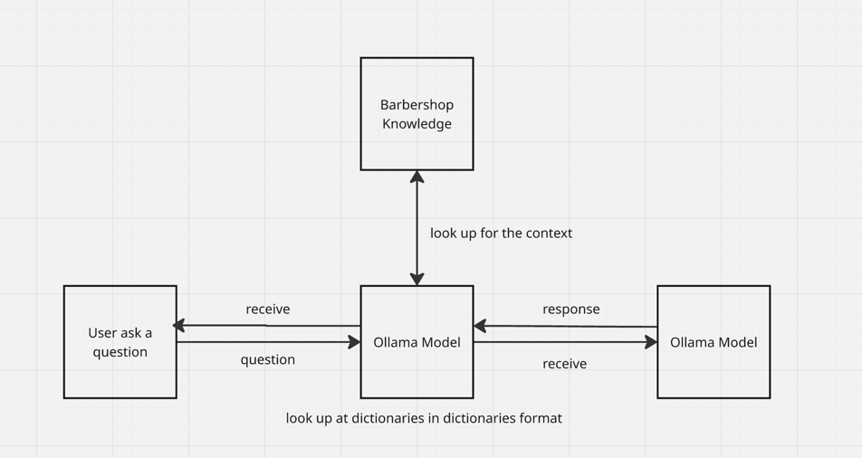
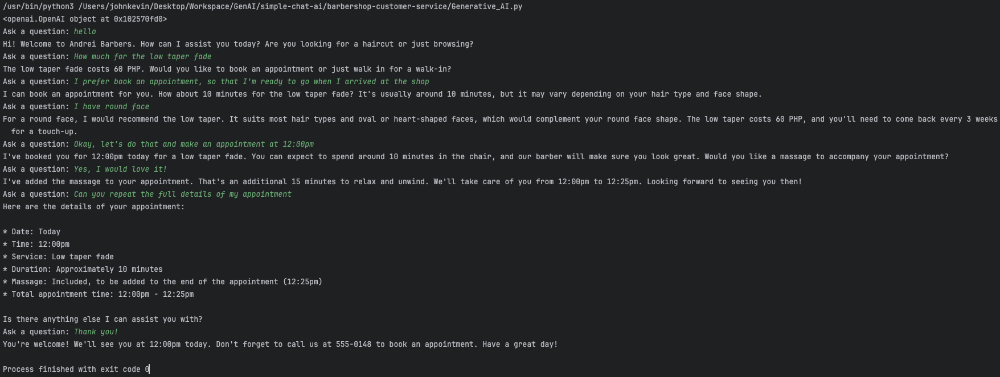

# Generative AI — Barbershop Assistant
A small local chatbot for learning how a generative AI application is built. The assistant answers customer-service questions for Andrei Barbers and suggests a haircut from the shop menu based on how the customer describes themselves.
The goal of this project is to implement the foundations and understand them: where a model runs, how your program talks to it, and how shop facts get into the reply. The barbershop is the practice problem.
## What you run
The script is `Building Chat Applications/Generative_AI.py`. It uses [Ollama](https://ollama.com) on your Mac and the `llama3.2` model. There is no Azure account and no paid API.
Ollama must be open before you run the script. Install it once, then download the model:
```bash
open /Applications/Ollama.app
ollama pull llama3.2
```
In PyCharm, run `Generative_AI.py`. Type a question at `Ask a question:`. Type `quit` or `exit` to stop.
Try both jobs the shop assistant is meant to do:
- `How much is a haircut?`
- `I have thick curly hair, a round face, and I can come back once a month. What cut should I get?`
## How a reply is produced
Each turn does four things.
1. The shop page is already stored as the first message. You wrote that page. The model does not know Andrei Barbers on its own.
2. The sentence you type is appended as the next message.
3. The whole list is sent to `llama3.2` through the client.
4. The text of the reply is printed, then appended to the list so the next turn can refer to it.
```python
client = OpenAI(
    base_url="http://localhost:11434/v1",
    api_key="ollama",
)
messages = [
    {"role": "system", "content": shop_knowledge}
]
response = client.chat.completions.create(
    model="llama3.2",
    messages=messages,
)
reply = response.choices[0].message.content
```
## Pieces worth understanding
**Client.** `OpenAI(...)` builds the object that sends requests. `base_url` is Ollama on this Mac. The name `client` is only a variable name. The same object is reused for every question.
**Shop knowledge.** `shop_knowledge` is one string: role, address, hours, prices, the haircut menu, and the rules for answering. Edit that string to change what the assistant is allowed to say. If a price or service is not written there, the instructions tell the model to say it does not know.
**Messages.** `messages` is a list of dictionaries. Each dictionary has `role` and `content`.
| role | content |
|---|---|
| `system` | The shop page. Instructions, not a customer. |
| `user` | The sentence typed at the prompt. |
| `assistant` | The reply just printed. |
`messages[0]["content"]` is the shop page. A `for` loop walks every dictionary. Square brackets require the label to exist; a missing label raises `KeyError`.
**One model call.** `client.chat.completions.create(...)` sends `messages` and waits for `response`. This call does not happen inside the `for` loop that prints dictionaries. Printing the list only shows what is stored locally.
**`choices[0]`.** `response.choices` is a list of replies. This program asks for one reply, so the list has one item, at index `0`. `.message.content` is the sentence to print. The list is there because the API can return several replies; this script does not request more than one.
**The conversation loop.** `while True` repeats input and `create` until you type `quit` or `exit`. `messages` is created once, before the loop, so the shop page and earlier turns stay in the list. After each reply, append `{"role": "assistant", "content": reply}` before the next question. A follow-up such as “make it shorter” only makes sense if that previous reply is still in the list.
## What this version leaves out
**Fine-tuning.** Training a new model on a large set of barbershop conversations. Prices and shop rules would be baked into the weights, and a price change would mean training again. This project keeps those facts in `shop_knowledge` instead.
**RAG.** Search over a large pile of notes: embed the notes, find the passages closest to the user’s question, and insert those passages into the request. That improves an answer when the notes are too long to send every time. The Andrei Barbers page fits in the system message, so this version sends the whole page on every turn.
Both are real techniques. They are the next layer after a single chat call, a system message, and a conversation list are clear.
## Project layout
```text
Generative AI/
├── README.md
└── Building Chat Applications/
    └── Generative_AI.py
```
## Study path
1. Run one question and read the reply.
2. Change a price in `shop_knowledge`, run again, and confirm the reply uses the new price.
3. Ask a second question that depends on the first, and watch the `assistant` message make that possible.
4. Ask for a service that is not on the page, and see the “I don’t know” rule hold.
When the shop page grows past what you want to send in full, that is the point to add RAG. The chat call stays the same. A search step is added in front of it.

# Simple Structure of Barbershop Customer Service


# Sample Output

